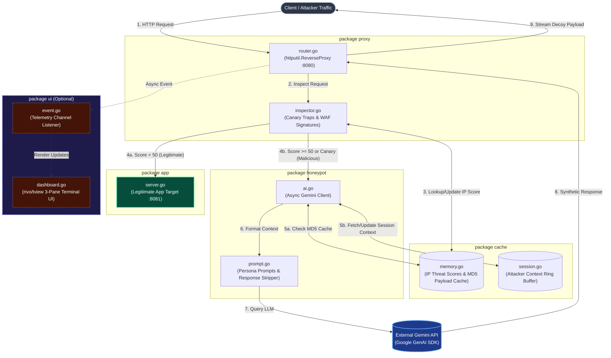

# ARGUS 

Anomalous Request Gateway and URI Simulator - intelligent network proxy build in Go. Instead of passively blocking attackers or routing them to static and easily identifiable honeypot ARGUS intercepts malicious traffic and uses LLMs to synthesize realistic fake server responses on the fly. It traps attackers into an endless digital mirage, wasting their resources while safely capturing threat intelligence.

## File structure:

```
argus/
├── main.go
├── config/
│   └── config.go         # API keys, upstream target URLs, canary route list
├── proxy/
│   ├── router.go         # Reverse proxy handler logic
│   └── inspector.go      # Canary, regex, and IP threat scoring engine
├── honeypot/
│   ├── ai.go             # Gemini API integration
│   └── prompt.go         # System persona prompts and template rendering
├── cache/
│   └── memory.go         # Thread-safe in-memory cache for generated responses
│   └── sessions.go       # Session logic for LLM model
├── ui/ [OPTIONAL]
│   ├── dashboard.go      # rivo/tview 3-pane layout & render loop
│   └── event.go          # Telemetry struct definition & channel listener
└── app/
    └── server.go         # Simple dummy server serving "legitimate" app responses
```

## Deliverables

1. Proxy gateway
2. Threat inspector
3. Client state tracker
4. AI-deception engine
5. Response cache system
6. Upstream production forwarder

## Architecture


